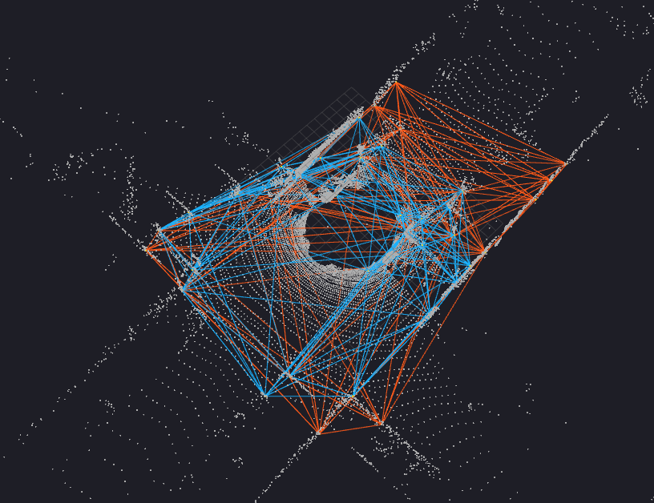
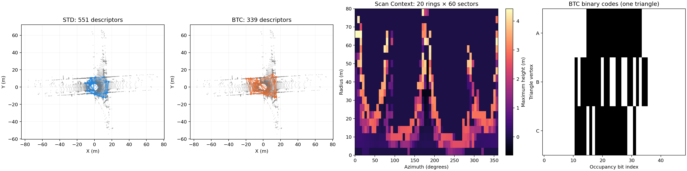

# ROS 2 三维点云描述子工作区
可视化如下


其中：



本工作区只保留 **STD、BTC、Scan Context** 三种描述子的核心算法及 ROS 2 提取节点。节点接受 `sensor_msgs/msg/PointCloud2`，逐帧导出 CSV，并发布 RViz2 可视化话题。核心 C++ 库也会安装到工作区，供自己的 SLAM 或定位节点链接。

| 描述子 | ROS 2 包 | 核心类型 | 单帧结果 |
|---|---|---|---|
| STD（Stable Triangle Descriptor） | `std_detector` | `STDescManager` | 多个带边长、角度和顶点的三角描述子 |
| BTC（Binary Triangle Combined） | `btc_desc` | `BtcDescManager` | 多个三角描述子及顶点二值编码 |
| Scan Context | `scancontext_ros2` | `SCManager` | 一个 20×60 的极坐标高度矩阵 |

## 文档

1. [安装、简介和示例数据](docs/01_INSTALL_AND_EXAMPLES.md)
2. [接口与输出格式](docs/02_API_AND_FORMATS.md)
3. [接入回环优化和重定位](docs/03_LOOP_AND_RELOCALIZATION.md)

## 快速体验

```bash
cd /home/ros/ros_ws/descriptor_ws
source /opt/ros/humble/setup.bash
colcon build --packages-select std_detector btc_desc scancontext_ros2
source install/setup.bash
ros2 launch scancontext_ros2 visualize_descriptors.launch.py
```

另开终端，执行 `source /opt/ros/humble/setup.bash` 和 `source install/setup.bash`，然后运行：

```bash
python3 tools/publish_example.py
```

示例输出在 [`examples/output`](examples/output)，对比图在 [`visualization/example_descriptors.png`](visualization/example_descriptors.png)。

本工作区的提取节点负责描述子生成、导出与可视化。回环因子、位姿图优化器、地图管理和重定位状态机由接入的 SLAM 系统提供；集成步骤见第三份文档。
